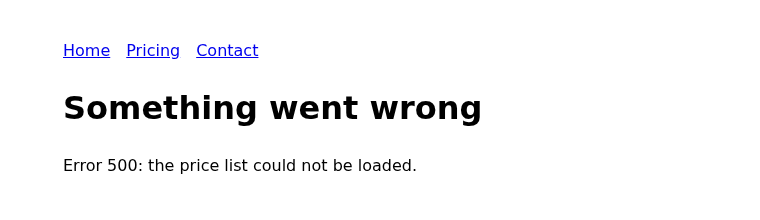

# CheckMyApp

**QA after every deploy, for teams that ship with a coding agent.**

[CheckMyApp](https://checkmyapp.dev) opens your live web app in a browser and walks the journeys that matter as a real user: sign up, sign in, checkout. Then it tells your coding agent what broke, where, and how to know it is fixed.

- One command to add it, one sign-in in your browser. No key to copy.
- $3 of checks free, no card.
- Works from Claude Code, Cursor, Codex, Cline and any MCP client.

```sh
claude mcp add --scope user --transport http checkmyapp https://checkmyapp.dev/mcp
```

Other clients: [Install](#install).

## What your agent gets

These are two real checks of our demo app, Harbor Notes, whose pricing page we broke on purpose. The words are the checks' own.

The first check found the break:

> **Pricing page returns a 500 error from every entry point** · broken · high
>
> **Where:** /pricing, reached via the home page "See pricing" button and the top-nav "Pricing" link
>
> **What we tried:** Clicked "See pricing" on the home page. Clicked "Pricing" in the top navigation.
>
> **What happened:** Both links load /pricing, which returns HTTP 500 and renders only "Something went wrong — Error 500: the price list could not be loaded." No plans or prices appear.
>
> **Why it matters:** Pricing is where interest becomes a purchase. With it down from every entry point, a ready-to-buy visitor hits a dead end and leaves — lost revenue. Once fixed, visitors would see your plans and prices and be able to choose one.

The screenshot that check saved at this step, cropped to the part of the page that has content:



We fixed the page. The next check, three minutes later:

> Your previously broken pricing page is fixed: both the home page "See pricing" link and the "Pricing" nav link now land on /pricing with a clean 200, no console errors, and the Crew plan ($12/month, one boat free) renders correctly on both routes.

Each finding comes with the screenshot of the step that saw it. A check names the symptom and the evidence; what to change in the code is your agent's call.

## About this repository

This repository holds the open-source connection configuration and plugin manifests for the hosted CheckMyApp service. The service implementation is not included. There is no server to build or run locally.

- **Endpoint:** `https://checkmyapp.dev/mcp`
- **Transport:** Streamable HTTP
- **Authentication:** OAuth sign-in; API keys are also available for CI
- **Setup:** https://checkmyapp.dev/install
- **Pricing:** https://checkmyapp.dev/pricing — paid service; a new account starts with $3 of checks, no card
- **Privacy:** https://checkmyapp.dev/privacy

## What you can do

- Add your app and define the journeys that matter.
- Check a deployed app and read findings with evidence.
- Give test accounts for journeys behind email-and-password sign-in.
- Manage recurring checks and inspect results from your agent.
- Connect the GitHub App for checks after deployments.

## Install

### Claude Code

```sh
claude mcp add --scope user --transport http checkmyapp https://checkmyapp.dev/mcp
```

Run `/mcp`, choose `checkmyapp`, and authenticate in your browser.

Or install the plugin instead of adding the server manually:

```text
/plugin marketplace add checkmyapp/checkmyapp-mcp
/plugin install checkmyapp@checkmyapp-plugins
```

### Cursor

Merge this entry into your user MCP configuration (`~/.cursor/mcp.json`):

```json
{
  "mcpServers": {
    "checkmyapp": {
      "url": "https://checkmyapp.dev/mcp"
    }
  }
}
```

Use Cursor's MCP authentication flow to sign in. This repository also includes a Cursor plugin manifest and root `mcp.json` for plugin installation.

### Cline

Merge this entry into `cline_mcp_settings.json` (open it from Cline's MCP Servers panel; the Cline CLI keeps it in `~/.cline/data/settings/`):

```json
{
  "mcpServers": {
    "checkmyapp": {
      "url": "https://checkmyapp.dev/mcp",
      "type": "streamableHttp",
      "disabled": false
    }
  }
}
```

Keep any servers already in the file. Then sign in to `checkmyapp` from the MCP Servers panel.

### Other MCP clients

Add `https://checkmyapp.dev/mcp` as a remote Streamable HTTP server and complete OAuth in your browser. API-key access is available for clients or CI jobs that do not support OAuth; follow the current instructions on the website and keep credentials outside repositories.

## Usage

After you sign in, ask your agent in plain words:

- “Set up CheckMyApp for this app.”
- “Did CheckMyApp find anything on my last deploy?”
- “Mark checkout as critical.”
- “What did CheckMyApp not check?”

Use apps you own or have permission to check. Starting a check consumes your team's balance; reading results does not start a check.

## Support and license

Contact [hello@checkmyapp.dev](mailto:hello@checkmyapp.dev).

The connection configurations and documentation in this repository are MIT licensed. This license does not grant rights to the hosted service implementation or CheckMyApp trademarks. Service use follows the terms shown by CheckMyApp.
